# Architecture de `twinhyp` — du fichier IFC à l'agent neuro-symbolique

> Document de synthèse : **quelles phases**, **quels scripts**, **quelles entrées / sorties**, **qui calcule quoi**, et **ce qui peut évoluer automatiquement**.
> Établi à partir du code de `src/twinhyp/` et des sorties de `sorties/` (run du 11/11/2026).

---

## Sommaire

1. [Vue d'ensemble en une image](#1-vue-densemble-en-une-image)
2. [Les entrées de la chaîne](#2-les-entrées-de-la-chaîne)
3. [Le squelette : commande, contexte, orchestrateur, contrats](#3-le-squelette--commande-contexte-orchestrateur-contrats)
4. [M1 — Jumeau géométrique (IFC → `geometry.json`)](#4-m1--jumeau-géométrique)
5. [Les deux couches de vérification des anomalies](#5-les-deux-couches-de-vérification-des-anomalies)
6. [M2 — Ontologie et graphe de connaissances](#6-m2--ontologie-et-graphe-de-connaissances)
7. [M3 — Choix optimal des nœuds IoT (reproduction IWCMC)](#7-m3--choix-optimal-des-nœuds-iot-reproduction-iwcmc)
8. [M4 — Déploiement SSI optimal (MILP)](#8-m4--déploiement-ssi-optimal-milp)
9. [M5 — Scénario d'évacuation dynamique](#9-m5--scénario-dévacuation-dynamique)
10. [M6 — L'agent : LLM, outils, règles, de bout en bout](#10-m6--lagent--llm-outils-règles-de-bout-en-bout)
11. [Tableau récapitulatif des flux I/O](#11-tableau-récapitulatif-des-flux-io)
12. [Ce qui change automatiquement… et ce qui ne change pas](#12-ce-qui-change-automatiquement-et-ce-qui-ne-change-pas)
13. [Commandes annexes](#13-commandes-annexes)

---

## 1. Vue d'ensemble en une image

**Principe directeur** : six modules **M1 → M6** enchaînés par `pipeline.py`. Les modules **ne se parlent que par des fichiers** (contrats JSON Schema / SHACL). Chaque sortie est **validée dès qu'elle est écrite** ; une sortie non conforme arrête la chaîne.

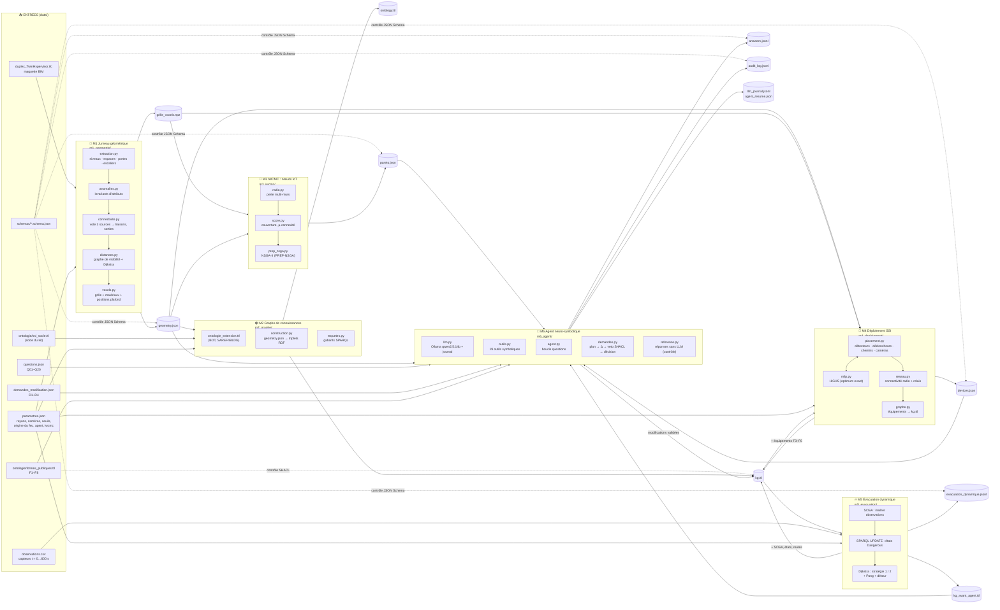

Version texte (lisible dans un terminal) :

```
 data/duplex.ifc ─┐
 parametres.json ─┤
                  ▼
           ┌──────────────┐  geometry.json        ┌──────────────┐ ontology.ttl
           │ M1 Géométrie │──────────────────────▶│ M2 Graphe KG │─────────────▶ kg.ttl (statique)
           └──────────────┘  grille_voxels.npz    └──────────────┘                  │
                  │                 │                                               │
                  │                 ▼                                               ▼
                  │         ┌──────────────┐                               ┌──────────────┐
                  │         │ M3 IWCMC IoT │── pareto.json ──┐             │ M4 SSI MILP  │── devices.json
                  │         └──────────────┘                 │             └──────────────┘
                  └─────────────────────────────────────────────────────────────▶│ kg.ttl (+équipements)
                                                             │                    ▼
                                       observations.csv ────────────────▶ ┌──────────────┐
                                                             │            │ M5 Évacuation│── evacuation_dynamique.jsonl
                                                             │            └──────────────┘
                                                             │                    │ kg.ttl (+SOSA, états, routes)
                                                             │                    ▼ kg_avant_agent.ttl
                        questions.json, demandes.json ──────▶└──────────▶ ┌──────────────┐
                        formes SHACL, Ollama (LLM local) ───────────────▶ │ M6 Agent     │── answers.jsonl
                                                                          └──────────────┘── audit_log.jsonl
                                                                                           ── kg.ttl (final)
```

---

## 2. Les entrées de la chaîne

| Fichier | Rôle | Contenu clé | Lu par |
|---|---|---|---|
| `data/duplex_TwinHypervisor.ifc` | Maquette BIM (IFC) | 4 niveaux, 21 espaces, 14 portes, 2 escaliers, murs/dalles/plafonds + matériaux | **M1** uniquement (+ vue 3D) |
| `data/parametres.json` | « Paramètres personnels » — **aucune valeur en dur dans le code** | `pas_grille_m` 0,5 · `detecteur_rayon_m` 5 · `declencheur_distance_max_m` 10 · caméra (90°×60°, 8 m, pose 2,4 m) · `couverture_video_min` 1,0 · `origine_feu` (A103) ; clés facultatives `iwcmc`, `agent`, seuils M5, `detecteur_type`, `mots_cles_non_occupable` | tous les modules (via `Contexte`) |
| `data/observations.csv` | Scénario incendie (4 087 lignes) | `t_s, horodatage, capteur, type, espace_globalId, valeur, unite` ; types : `SmokeAlarm` (1/m), `TemperatureSensor` (°C), `COSensor` (ppm), `Camera` (personnes) | **M5** (+ commande `detecteurs`) |
| `data/questions.json` | 20 questions (`ensemble` ou `valeur`) | Q01–Q14 statiques, Q15–Q19 scénario, Q20 IWCMC | **M6** |
| `data/demandes_modification.json` | 4 demandes d'opérateur | D1 cuisine → chaleur · D2 déplacer équipement A201→A202 · D3 retirer détecteurs Level 2 · D4 diriger vers l'escalier à t=200 s | **M6** |
| `data/ontologie/ssi_socle.ttl` | Ontologie socle du kit (OWL) | classes `Door/Exit/Stair/Detector/SmokeDetector/HeatDetector/ManualCallPoint/Camera/EvacuationPath/EvacuationRoute/Status…`, propriétés `isConnectedTo`, `hasDistance`, `hasStatus`, `coversSpace`… | **M2** |
| `data/ontologie/formes_publiques.ttl` | 8 formes SHACL F1–F8 (règles SSI) | F1 espace/niveau · F2 portes/sorties · F3 détection · F4 déclencheurs · F5 vidéo · F6 zones · F7 distances · **F8 route sûre** | validation + **veto de l'agent** |
| `data/schemas/*.schema.json` | Contrats JSON des sorties | geometry, pareto, devices, evacuation_dynamique, answers, audit_log | `io_schemas.py` |

---

## 3. Le squelette : commande, contexte, orchestrateur, contrats

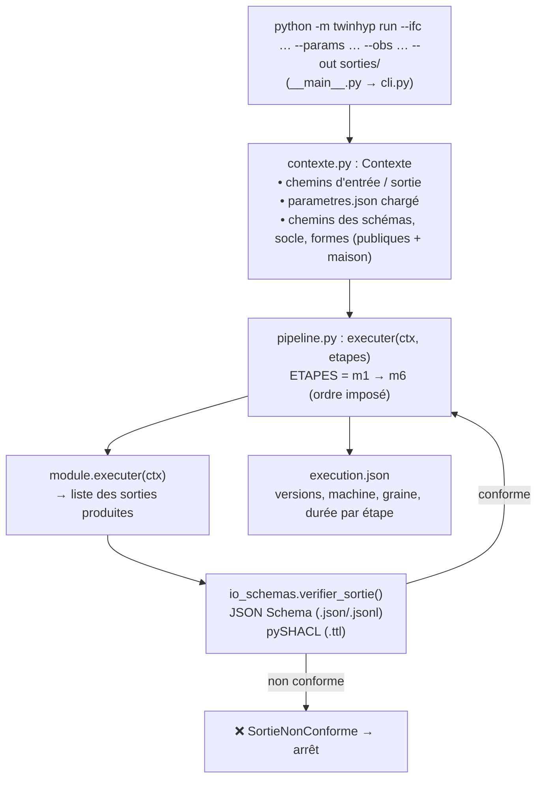

| Script | Ce qu'il fait |
|---|---|
| `cli.py` | Une commande unique (`run`, `valider`, `visualiser`, `questions`, `sensibilite`, `campagne`, `detecteurs`, `comparer`, `scenario`). `--etapes m1,m2` relance une partie de la chaîne depuis les sorties existantes. |
| `contexte.py` | Objet `Contexte` passé à **tous** les modules : chemins + `params` (lus de `parametres.json`) + liste des formes SHACL = `formes_publiques.ttl` **+** `m2_graphe/formes_maison.ttl`. |
| `pipeline.py` | Importe dynamiquement chaque module, mesure le temps, appelle `verifier()`. **Subtilité** : pour M1–M3, les formes F3–F6 (équipements) sont **différées** (le graphe n'a pas encore d'équipements) ; dès M4, F1–F8 s'appliquent toutes. |
| `io_schemas.py` | Écriture JSON/JSONL, validation JSON Schema (Draft 2020-12), validation SHACL d'un fichier **ou d'un graphe en mémoire** (`formes_violees_graphe`, utilisée par le veto de l'agent). |

---

## 4. M1 — Jumeau géométrique

> **Entrée** : `duplex.ifc` + `parametres.json` → **Sortie** : `geometry.json` (+ `grille_voxels.npz`)
> **Règle d'or** : tout est indexé par **GlobalId**, jamais par nom ; aucune règle ne connaît les noms du duplex.

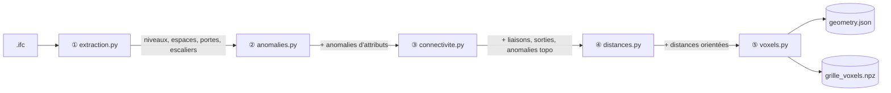

### ① `extraction.py` — lire la maquette

| Entrée | Calcul | Sortie (dans `geometry.json`) |
|---|---|---|
| `IfcBuildingStorey` | nom, altitude | `niveaux[]` |
| `IfcSpace` (+ maillage via `ifc_outils.py`) | polygone XY (union des triangles projetés), hauteur, z bas, surface « GSA BIM Area » (repli : géométrique), occupable (mots-clés `roof, toit, shaft, gaine, plenum…`) | `espaces[]` |
| `IfcDoor` | largeur, hauteur, position, espaces bordés (`IfcRelSpaceBoundary`) | `portes[]` |
| `IfcStair` | marches, giron, base/sommet | `escaliers[]` |

### ② `anomalies.py` — invariants d'attributs (voir §5)

### ③ `connectivite.py` — qui communique avec qui ?

* **Portes** : trois sources **indépendantes**, décision à la **majorité (≥ 2/3)** :
  * **A. IFC** : espaces ayant une `IfcRelSpaceBoundary` sur la porte ;
  * **B. Chaîne de Pang** : porte → ouverture (`IfcRelFillsElement`) → mur hôte (`IfcRelVoidsElement`) → espaces qui longent ce mur ;
  * **C. Géométrie** : espaces dont le contour passe à < 0,40 m de la porte.
* **Ouvertures libres** : limites `VIRTUAL` de l'IFC ∩ contours qui se touchent sur ≥ 0,60 m sans mur.
* **Escaliers** : espace bas (départ de la volée) ↔ espace haut (arrivée).
* **Sorties** : porte reliant un seul espace intérieur (géométrie + `IsExternal`).
* Contrôle final : **tout espace occupable atteint une sortie** (`espace_evacuable`).

➡️ Résultat : 20 liaisons (10 portes, 8 ouvertures, 2 escaliers), 4 sorties.

### ④ `distances.py` — distances d'évacuation orientées

Pour chaque liaison A → B : distance **du point le plus défavorable de A** jusqu'au passage vers B, en contournant les murs (graphe de visibilité sur les sommets du polygone + Dijkstra) ; + longueur de volée pour un escalier. d(A→B) ≠ d(B→A).
La formule de Pang est calculée à côté pour comparaison (`pangDistance`).
➡️ 40 distances orientées + 4 distances vers les sorties.

### ⑤ `voxels.py` — grille 3D pour la radio et les caméras

* Grille 16 × 34 × 24 (0,5 × 0,5 × 0,25 m) sur l'emprise des espaces occupables.
* **Rayons verticaux** + parité des intersections → chaque voxel : libre / obstacle + **catégorie de matériau** (`plaque_de_platre`, `mur_beton`, `mur_porteur`, `bois`, `autre`) via la table déclarative `MATERIAUX` (regex sur les noms de matériaux IFC).
* **Positions autorisées** `A` : impact du rayon sur le plafond au-dessus d'un espace occupable → 932 positions.
* Sorties : `grille_voxels.npz` (tableaux) ; résumé + positions dans `geometry.json` (`voxels`, `positions_autorisees`).

### Contenu final de `geometry.json`

`source · niveaux · espaces · portes · escaliers · liaisons · anomalies · distances · distances_sortie · voxels · positions_autorisees`

---

## 5. Les deux couches de vérification des anomalies

> ⚠️ Différence avec l'intuition « vérification = IFC + ontologie » : dans l'app, la vérification se fait en **deux couches distinctes**, à deux moments différents.

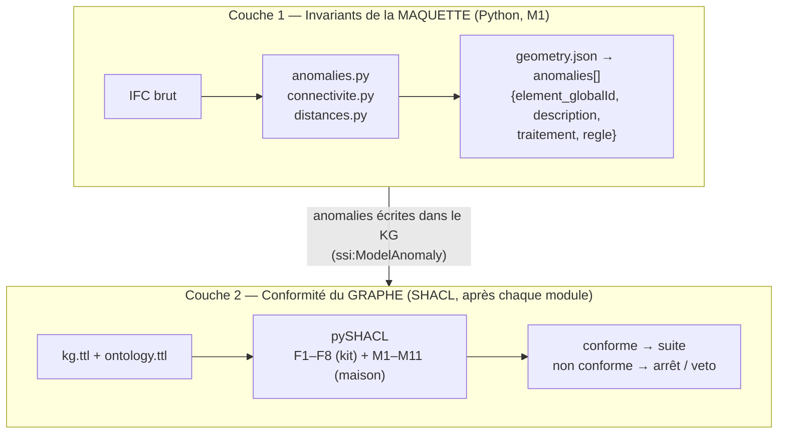

### Couche 1 — règles d'invariants sur l'IFC (chaque règle = un invariant qu'une maquette saine respecte)

| Règle (`regle`) | Script | Invariant | Constat sur le duplex |
|---|---|---|---|
| `nom_unique` | anomalies.py | un nom d'espace est unique | `B202` porté par 2 espaces |
| `nom_coherent_proprietes` | anomalies.py | nom IFC = `Number`/`Reference` des psets | « Bedroom 2 » = en réalité `B203` |
| `fonction_coherente` | anomalies.py | deux espaces jumeaux ont la même fonction | B105 « Room » vs A105 « Stair » |
| `booleen_type` | anomalies.py | un booléen est un booléen | `IsFireExit` = texte |
| `rattachement_niveau` | anomalies.py | un élément est rattaché au niveau de sa base | escalier B rattaché au toit |
| `rattachement_spatial` | anomalies.py | tout élément est contenu dans un niveau | porte A202–A201 orpheline |
| `dimensions_escalier` | anomalies.py | marche 0,10–0,25 m, giron 0,20–0,40 m | valeurs en **pieds** |
| `porte_sources_concordantes` | connectivite.py | les 3 sources s'accordent | porte A204–A205 reliée à tort à A201 |
| `chevauchement_espaces` | connectivite.py | deux espaces ne se chevauchent pas | cages A105/B105 empiètent de 0,15 m² |
| `limite_bien_placee` | connectivite.py | une limite virtuelle est sur le contour | A201/B201 décalées de 6–10 m |
| `limite_type_coherent` | connectivite.py | limite entre 2 espaces ≠ « EXTERNAL » | 12 limites mal typées |
| `porte_deux_espaces`, `sortie_coherente`, `escalier_relie`, `espace_evacuable`, `distance_calculable` | connectivite.py / distances.py | règles de garde | aucune violation |

Chaque anomalie porte un **traitement** (ce que fait la chaîne : « identifier par GlobalId », « la géométrie fait foi »…). ➡️ **16 anomalies** dans `geometry.json`.

### Couche 2 — formes SHACL sur le graphe

| Formes | Origine | Quand |
|---|---|---|
| **F1–F8** | `data/ontologie/formes_publiques.ttl` (kit) | après M2 (F3–F6 différées jusqu'à M4), M4, M5, M6 ; **et** à chaque décision de l'agent |
| **M1–M11** (« maison ») | `src/twinhyp/m2_graphe/formes_maison.ttl` | idem — anticipent les formes cachées du jury (symétrie, distance par liaison, évacuabilité, unicité GlobalId, paramètres, portes même niveau…) |

---

## 6. M2 — Ontologie et graphe de connaissances

> **Entrées** : `geometry.json` + `parametres.json` + `ssi_socle.ttl` → **Sorties** : `ontology.ttl`, `kg.ttl` (~880 triplets)
> M2 **ne relit jamais l'IFC**.

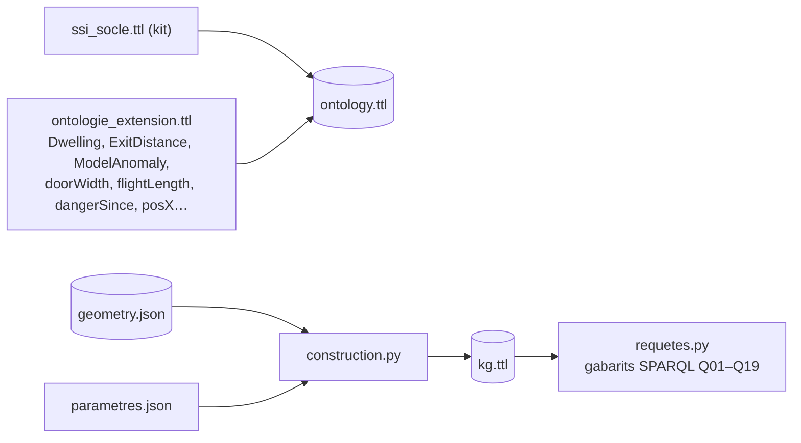

### L'ontologie : qui est relié à qui

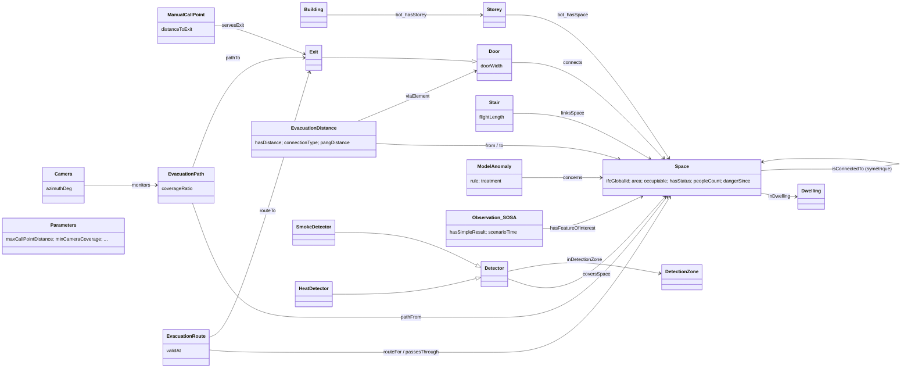

### Patrons de construction (`construction.py`)

| Patron | Exemple |
|---|---|
| Topologie BOT | `Site → Building → Storey → Space` |
| Connectivité | `ssi:isConnectedTo` écrit **dans les deux sens** (SPARQL sans raisonneur) |
| Distance = relation n-aire réifiée | `ssi:EvacuationDistance` (from, to, hasDistance, connectionType, viaElement), une par sens |
| Logement | composante connexe du graphe contenant une sortie (règle générique, pas le préfixe du nom) |
| Paramètres | un seul nœud `ssi:Parameters` |
| IRI stables | `…/kg/<type>/<GlobalId>` |

`requetes.py` : gabarits SPARQL paramétrés (un par intention) + `graphe_pondere()` qui reconstruit le graphe orienté des distances **depuis le KG** (utilisé par M5 et M6).

---

## 7. M3 — Choix optimal des nœuds IoT (reproduction IWCMC)

> **Entrées** : `grille_voxels.npz` + `positions_autorisees` (geometry.json) + clé `iwcmc` → **Sortie** : `pareto.json` (4 scénarios) + `sorties/iwcmc/`
> Question : *combien de nœuds radio, et où, pour couvrir le bâtiment ?*

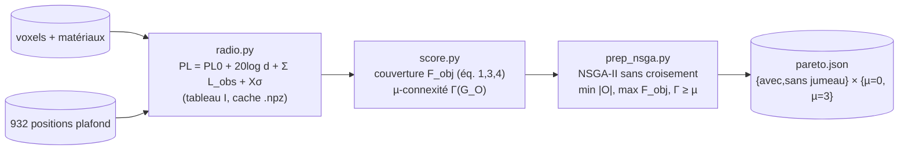

* **« Avec jumeau »** : chaque obstacle a son vrai matériau. **« Sans jumeau »** : on optimise en supposant tout obstacle dans le matériau le plus absorbant, puis on évalue dans le vrai bâtiment.
* Variante `facteur_attenuation × 30` (`pareto_facteur30.json`) pour expliquer l'écart aux figures de l'article.
* **Q20** (`m3_iwcmc.q20`) = plus petit nombre de nœuds du front « avec jumeau, µ=0 » atteignant 90 %.
* `reseau.py` (M4) **réutilise** ce modèle radio pour vérifier la connectivité des équipements SSI.

---

## 8. M4 — Déploiement SSI optimal (MILP)

> **Entrées** : `geometry.json` + `grille_voxels.npz` + `parametres.json` + `kg.ttl` → **Sorties** : `devices.json`, `kg.ttl` enrichi (F3–F6 désormais exigées)

Formulation **séquentielle**, chaque sous-problème résolu **exactement** par HiGHS (`milp.py`, statut et gap rapportés) :

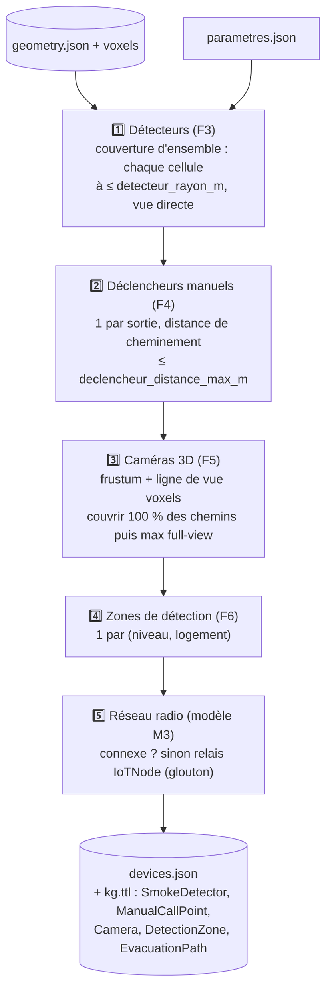

| Sous-problème | Script / fonction | Candidats | Contrainte | Résultat duplex |
|---|---|---|---|---|
| Détecteurs | `placement.detecteurs` | positions plafond du même espace | chaque cellule couverte | 20 DF (1 / espace occupable) |
| Déclencheurs | `placement.declencheurs` | 1 point / sortie, 0,4 m côté intérieur, 1,2 m | distance ≤ 10 m | 4 DM |
| Chemins | `placement.chemins` | itinéraires M1 échantillonnés à 1,6 m | — | 20 chemins |
| Caméras | `placement.cameras` | positions × 8 azimuts × 2 inclinaisons | couverture ≥ `couverture_video_min` | 18 CAM, 100 % des chemins |
| Zones | `__init__.zones_detection` | — | jamais 2 niveaux | 4 zones |
| Réseau | `reseau.analyser / relais` | positions autorisées | connexité | connexe, 0 relais |

Le type de détecteur (`SmokeDetector` / `HeatDetector`) se règle par `detecteur_type` ; `fumee_chaleur.py` compare les deux sur les mesures (commande `detecteurs`).

---

## 9. M5 — Scénario d'évacuation dynamique

> **Entrées** : `kg.ttl` (après M4) + `observations.csv` + seuils (`parametres.json`) → **Sorties** : `evacuation_dynamique.jsonl`, `kg.ttl` (+ observations SOSA, états, alarme, routes), `kg_avant_agent.ttl`
> Algorithme 1 de Pang, **mais** avec une contrainte **dure** (F8) au lieu de la pénalité de 1 000 m.

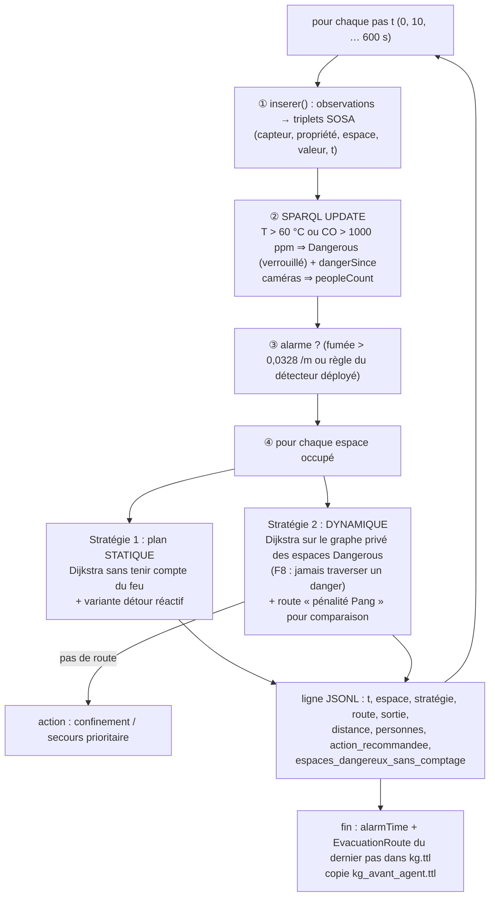

Résultats : alarme à 70 s ; A101 dangereux à 180 s ⇒ plus de route sûre pour A202/A203 (confinement) ; Pang leur proposerait 1 026 m **à travers le feu**.

---

## 10. M6 — L'agent : LLM, outils, règles, de bout en bout

> **Entrées** : `kg_avant_agent.ttl`, `pareto.json`, `devices.json`, `geometry.json`, `ontology.ttl`, formes SHACL, `questions.json`, `demandes_modification.json`, **Ollama** (`qwen2.5:14b`, local, température 0, graine 0)
> **Sorties** : `answers.jsonl`, `audit_log.jsonl`, `kg.ttl` modifié, `llm_journal.jsonl`, `agent_resume.json`

### 10.1 Principe neuro-symbolique

| Le **LLM** (neuro) fait… | Le **code** (symbolique) fait… |
|---|---|
| comprendre la question, choisir l'outil et ses arguments | calculer la réponse (SPARQL, Dijkstra, MILP, Pareto) |
| traduire une demande en **plan JSON** contraint par schéma | calculer le delta de triplets, générer les adaptations |
| rédiger la justification | **décider** (veto SHACL + ordre lexicographique) |
| — | comparer chaque réponse à la **référence sans LLM** |

**Le LLM ne recopie jamais un identifiant et ne peut pas changer une décision.**

### 10.2 Composants

| Script | Rôle |
|---|---|
| `llm.py` | Client Ollama (`/api/chat`, function calling), **journal de chaque appel** (prompt, réponse, jetons, durées, digest du modèle). `Rejeu` rejoue un journal sans Ollama ; `Factice` pour les tests. |
| `outils.py` | **19 outils** dans le registre `OUTILS` (nom → fonction, description, schéma JSON des arguments). `Boite` = ce que voient les outils (graphe + sorties M3/M4). |
| `agent.py` | Prompt système + **résumé du bâtiment construit par SPARQL** ; boucle ReAct bornée (`max_iterations` = 3) avec auto-correction. |
| `demandes.py` | Pipeline plan → Δ → veto SHACL → adaptations → décision → justification. |
| `reference.py` | Réponses de référence Q01–Q20 **sans LLM** (gabarits + planificateur). |
| `__init__.py` | Orchestration : questions, puis demandes, puis écriture des sorties ; repart toujours de `kg_avant_agent.ttl` (idempotent). |

### 10.3 Les 19 outils (familles)

| Famille | Outils |
|---|---|
| **Requêtes SPARQL (gabarits)** | `espaces_du_niveau`, `portes_exterieures`, `espaces_avec_sortie_directe`, `espaces_ouverts_vers`, `surface_totale`, `espaces_a_porte_unique`, `liaisons_verticales`, `plus_grand_espace_par_logement`, `espaces_du_niveau_par_type`, `passages_entre_logements`, `portes_plus_etroites_que` |
| **SPARQL libre (lecture seule)** | `sparql` (UPDATE refusé) |
| **Planificateur d'évacuation** | `itineraire`, `route_evacuation`, `instant_sans_route_sure` |
| **Scénario** | `premiere_alarme_fumee`, `espaces_dangereux`, `espaces_occupes` |
| **Optimiseur** | `front_pareto_iwcmc` (M3) ; *(interne aux demandes : `placer_detecteurs_niveau`, MILP de M4)* |
| **Validation** | `Validateur` SHACL sur copie (interne aux demandes) |

### 10.4 Flux « question »

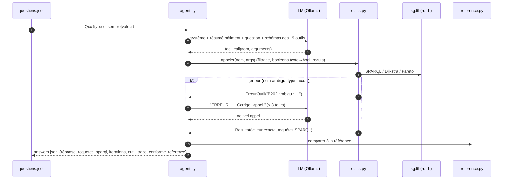

➡️ Run réel : **20/20 conformes**, 21 itérations au total (Q08 auto-corrigée après « B202 ambigu »).

### 10.5 Flux « demande de modification »

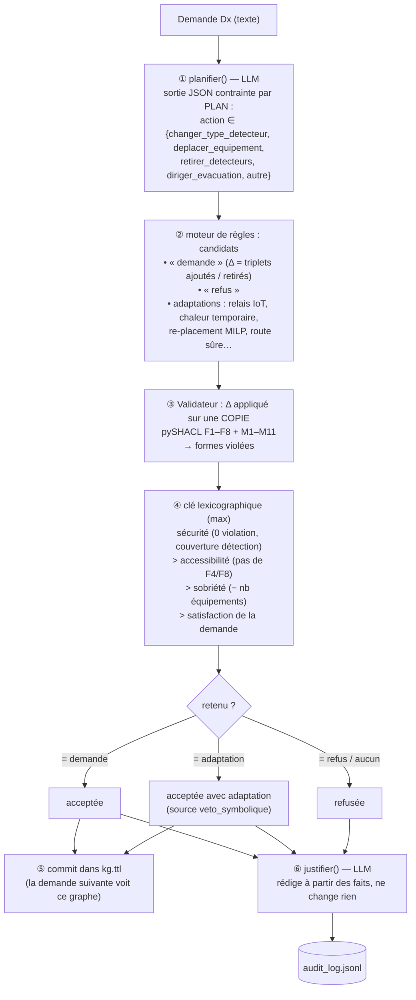

| Demande | Plan (LLM) | Verdict symbolique | Décision |
|---|---|---|---|
| D1 cuisine → chaleur | `changer_type_detecteur` | aucune forme violée | **acceptée** |
| D2 déplacer l'équipement de A201 vers A202 | `deplacer_equipement` | A201 sans détecteur ⇒ **F3** | **refusée** (le candidat « relais IoT » est valide aussi, mais « refus » l'emporte par sobriété : un équipement de moins) |
| D3 retirer les détecteurs du Level 2 | `retirer_detecteurs` | **F3** violée | **acceptée avec adaptation** : détecteurs de chaleur temporaires |
| D4 escalier par la route habituelle à t=200 s | `diriger_evacuation` (traité par espace, état reconstruit à t=200 via `dangerSince`) | route habituelle traverse un espace Dangerous ⇒ **F8** | **refusée** → mise à l'abri |

---

## 11. Tableau récapitulatif des flux I/O

| # | Module | Scripts lancés | Lit | Écrit | Validé par |
|---|---|---|---|---|---|
| 0 | squelette | `cli.py`, `contexte.py`, `pipeline.py` | arguments, `parametres.json` | `execution.json` | — |
| 1 | **M1** | `extraction` → `anomalies` → `connectivite` → `distances` → `voxels` (+ `ifc_outils`) | `.ifc`, `parametres.json` | `geometry.json`, `grille_voxels.npz` | `geometry.schema.json` |
| 2 | **M2** | `construction`, `requetes` | `geometry.json`, `ssi_socle.ttl`, `ontologie_extension.ttl`, params | `ontology.ttl`, `kg.ttl` | SHACL F1,F2,F7,F8 + maison |
| 3 | **M3** | `radio` → `score` → `prep_nsga` (+ `sensibilite`, `campagne` en option) | `grille_voxels.npz`, `geometry.json`, params `iwcmc` | `pareto.json`, `iwcmc/*` | `pareto.schema.json` |
| 4 | **M4** | `placement` ⇄ `milp` → `reseau` → `graphe` | `geometry.json`, `grille_voxels.npz`, params, `kg.ttl` | `devices.json`, `kg.ttl` | `devices.schema.json` + SHACL **F1–F8** |
| 5 | **M5** | `m5_evacuation/__init__` (+ `fumee_chaleur.declencheur_alarme`) | `kg.ttl`, `observations.csv`, seuils | `evacuation_dynamique.jsonl`, `kg.ttl`, `kg_avant_agent.ttl` | schéma + SHACL |
| 6 | **M6** | `llm`, `agent`, `outils`, `demandes`, `reference` | `kg_avant_agent.ttl`, `pareto.json`, `devices.json`, `geometry.json`, formes, `questions.json`, `demandes.json` | `answers.jsonl`, `audit_log.jsonl`, `kg.ttl`, `llm_journal.jsonl`, `agent_resume.json` | schémas + SHACL |
| — | visu | `visualisation/plan2d, vue3d, voxels, iwcmc` | sorties | `figures/*.html` | — |

**Évolution de `kg.ttl` au fil de la chaîne :**

```
M2 : topologie + distances + anomalies + paramètres      (~880 triplets, statique)
M4 : + détecteurs, déclencheurs, caméras, zones, chemins  (F3–F6 satisfaites)
M5 : + observations SOSA, états Dangerous, dangerSince, alarmTime, routes courantes
     └─▶ copie figée : kg_avant_agent.ttl
M6 : + / − triplets des demandes acceptées (après veto SHACL)   → kg.ttl final
```

---

## 12. Ce qui change automatiquement… et ce qui ne change pas

### 12.1 Carte des niveaux d'adaptabilité

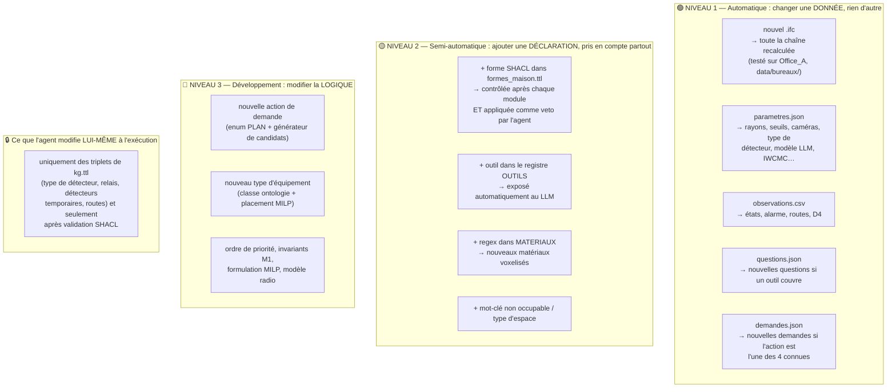

### 12.2 Détail niveau par niveau

#### 🟢 Niveau 1 — il suffit de changer une donnée

| On change… | Ce qui se recalcule tout seul | Où c'est lu |
|---|---|---|
| **Le fichier IFC** | Extraction, anomalies, liaisons, distances, voxels, graphe, Pareto, déploiement, routes, réponses de l'agent. Aucun nom ni GlobalId du duplex dans la logique (seul `reference.py` cite les noms des questions du kit). Démontré sur `data/bureaux/Office_A_20110811.ifc` → `sorties_bureaux/`. | `ctx.ifc` |
| **`parametres.json`** | `detecteur_rayon_m` → nb de détecteurs ; `declencheur_distance_max_m` → F4 ; caméra (champ, portée, hauteur) + `couverture_video_min` → F5 ; `pas_grille_m` ; `origine_feu` ; seuils M5 (`seuil_danger_temperature_degC`, `seuil_danger_co_ppm`, `seuil_alarme_obscurcissement_par_m`, `penalite_pang_m`) ; `detecteur_type` (fumée/chaleur) ; `detecteur_chaleur_*` ; `iwcmc.*` (technologie, P_TX, S_RX, NSGA…) ; `agent.*` (modèle, url, graine, max_iterations) ; `mots_cles_non_occupable`. Ces valeurs sont aussi écrites dans le nœud `ssi:Parameters` du KG, donc **les formes F4/F5 se règlent automatiquement**. | `ctx.params` |
| **`observations.csv`** | États Dangerous, instant d'alarme, routes, confinements, décision D4. Pour un autre bâtiment : `python -m twinhyp scenario` génère un scénario synthétique au même format. | M5 |
| **`questions.json`** | Le LLM choisit parmi les 19 outils ; une question nouvelle est traitée **si un outil la couvre** (ou via l'outil `sparql` libre). Pas de contrôle de référence pour une question hors kit. | M6 |
| **`demandes_modification.json`** | Traitées si le plan entre dans une des 4 actions ; sinon `autre` → « refusée : action non prise en charge » (jamais d'action improvisée). | M6 |
| **Le modèle LLM** | `TWINHYP_LLM_MODELE=…` ou `agent.modele` ; `TWINHYP_LLM_REJEU=journal` pour rejouer sans Ollama. | `m6_agent/__init__.py` |

#### 🟡 Niveau 2 — ajouter une déclaration, l'app la propage

| Extension | Effet automatique | Exemple |
|---|---|---|
| **Règle de sécurité supplémentaire** = nouvelle `sh:NodeShape` dans `src/twinhyp/m2_graphe/formes_maison.ttl` (ou un nouveau fichier ajouté à `Contexte.formes`) | ① vérifiée après chaque module par `pipeline.verifier` ; ② **utilisée comme veto par l'agent** (`Validateur` reçoit `ctx.formes`) : toute demande qui la viole est refusée ou adaptée, sans toucher au code de l'agent ; ③ `python -m twinhyp valider` la contrôle sur des sorties existantes. Gravité `sh:Violation` = bloquante, `sh:Warning` = signalée. | « chaque chambre a un détecteur de chaleur ou de fumée », « une caméra par sortie », « une route ne passe pas par une cage d'escalier dangereuse »… Les **formes cachées du jury** s'intègrent de la même façon. |
| **Nouvel outil** pour l'agent = une entrée dans `OUTILS` (`outils.py`) : fonction + description + schéma JSON | Exposé automatiquement au LLM (`schemas_ollama()`), arguments filtrés et validés par `appeler()`, erreurs renvoyées au LLM pour auto-correction. | « espaces sans caméra », « équipements d'une zone »… |
| **Nouveau matériau** = regex dans `MATERIAUX` (`voxels.py`) | Voxelisation, modèle radio M3, connectivité M4. | `r"glass|verre"` |
| **Type d'espace / mot-clé non occupable** | `TYPES_ESPACE` (outils.py), `mots_cles_non_occupable` (params) | « garage » non occupable |

#### 🔴 Niveau 3 — nécessite du développement

* **Nouvelle action de demande** (ex. « ajouter une sortie ») : ajouter la valeur à l'`enum` de `PLAN` **et** un générateur de candidats dans `demandes.py` (Δ de triplets + adaptations). La suite (veto, classement, commit, audit) est déjà générique.
* **Nouveau type d'équipement** (sirène, extincteur, BAES…) : classe dans l'ontologie, préfixe dans `PREFIXE_ID`, sous-problème MILP dans `placement.py`, écriture dans `graphe.py`, forme SHACL.
* **Ordre de priorité** sécurité > accessibilité > sobriété : codé dans `evaluer()` (volontairement hors d'atteinte du LLM).
* **Invariants de la couche 1** (anomalies IFC), **formulations MILP**, **modèle radio** : Python.
* **Socle et F1–F8** : fournis par le kit, **non modifiés** par l'app (l'app étend, elle ne réécrit pas).

#### 🔒 Ce qui ne change JAMAIS automatiquement

* L'agent **n'apprend pas** et **n'écrit pas de règles** : il ne modifie ni l'ontologie, ni les formes, ni les outils, ni le code.
* Il ne modifie que des **triplets du graphe**, uniquement pour un candidat **validé par SHACL** et retenu par l'ordre lexicographique ; chaque modification est tracée dans `audit_log.jsonl` (nb de triplets ajoutés / retirés, formes violées, candidats évalués, source de la décision : `llm`, `regle` ou `veto_symbolique`).
* Une réponse qui diffère de la référence est **signalée** (`conforme_reference: false`), jamais corrigée en silence.

---

## 13. Commandes annexes

| Commande | Rôle |
|---|---|
| `python -m twinhyp run … --etapes m4,m5` | relancer une partie de la chaîne |
| `python -m twinhyp valider --out sorties` | revalider schémas + SHACL |
| `python -m twinhyp visualiser --out sorties` | `figures/plan_2d.html`, `vue_3d.html`, `voxels.html`, `iwcmc.html` |
| `python -m twinhyp questions --out sorties [--sparql]` | réponses de référence par SPARQL |
| `python -m twinhyp sensibilite / campagne --out sorties` | analyses IWCMC |
| `python -m twinhyp detecteurs --out sorties` | fumée vs chaleur |
| `python -m twinhyp comparer sorties sorties_chaleur …` | comparer deux runs étape par étape |
| `python -m twinhyp scenario …` | observations synthétiques pour un autre IFC |
| `pytest` / `pytest -m "not integration"` | tests (unitaires, conformité, intégration) |
