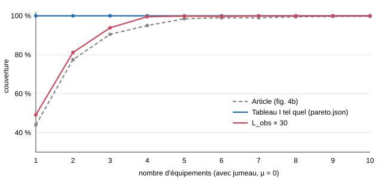

# Du BIM au SSI neuro-symbolique — rapport

Exercice CIFRE TwinHypervisor (Université Gustave Eiffel) · Emerick Lafortune · 11 novembre 2026
Dépôt : `elafortune/twin_hypervisor` · reproduction : `python -m twinhyp run --ifc data/duplex_TwinHypervisor.ifc --params data/parametres.json --obs data/observations.csv --out sorties`

## 1. Architecture de la chaîne

Six modules Python indépendants (`src/twinhyp/m1_…` à `m6_…`), qui ne communiquent **que par les fichiers de sortie** ; chacun se relance seul (`--etapes`). Chaque sortie est validée contre son contrat (JSON Schema du kit, formes SHACL publiques F1–F8 et 11 formes « maison ») à la fin de l'étape qui la produit : une sortie non conforme arrête la chaîne. Aucune valeur n'est codée en dur : tout vient de `parametres.json` (les clés ajoutées ont un défaut dans le code et sont recopiées dans le nœud `ssi:Parameters` du graphe, ce qui règle F4/F5 « paramètre personnel »).

| Module | Entrée → sortie | Méthode |
|---|---|---|
| M1 jumeau géométrique | IFC → `geometry.json` | IfcOpenShell ; connectivité des portes par **vote de 3 sources** (limites IFC, chaîne mur → ouverture → porte de Pang, contact géométrique) ; distances au point le plus défavorable (graphe de visibilité + Dijkstra) ; voxels 0,5 × 0,5 × 0,25 m avec matériau ; positions autorisées au plafond |
| M2 graphe | `geometry.json` → `ontology.ttl`, `kg.ttl` | rdflib ; socle `ssi:` étendu et aligné sur BOT, SOSA, SAREF4BLDG ; IRI = GlobalId |
| M3 IWCMC | voxels → `pareto.json` | modèle multi-murs (éq. 2, tableau I), score, µ-connexité, PREP-NSGA (tableau II), 4 scénarios |
| M4 déploiement SSI | → `devices.json`, `kg.ttl` | MILP exacts (HiGHS) : *set cover* des détecteurs, déclencheurs, caméras 3D (couverture puis *full-view*), zones, réseau |
| M5 évacuation | observations → `evacuation_dynamique.jsonl` | rejeu SOSA pas à pas, états `Dangerous` par SPARQL UPDATE, stratégie 1 (statique) et 2 (contrainte dure) |
| M6 agent | questions, demandes → `answers.jsonl`, `audit_log.jsonl` | LLM local (Ollama, qwen2.5:14b) + 19 outils ; veto SHACL ; ordre sécurité > accessibilité > sobriété |

Outils, tous libres : Python 3.11, ifcopenshell, shapely, numpy, networkx, rdflib, pySHACL, HiGHS (highspy), plotly, Ollama. 133 tests automatisés (pytest), dont des tests sur des cas synthétiques indépendants du duplex.

## 2. Incohérences de la maquette

Toutes vérifiées à la main dans BIMvision (`docs/verification_bimvision.md`) ; chacune est écrite dans `geometry.json` (élément, description, traitement) et dans le graphe (`ssi:ModelAnomaly`).

| Constat | Traitement |
|---|---|
| Deux espaces nommés `B202` ; « Bedroom 2 » porte le numéro Revit `B203` | identification par GlobalId ; ambiguïté signalée à l'agent (Q08) |
| B105 « Room » alors que son OmniClass est « Stairway » (jumeau de A105 « Stair ») | traité comme cage d'escalier |
| `IsFireExit` vaut le texte « IsFireExit » sur les 14 portes | ignoré ; sorties par géométrie + `IsExternal` |
| Escalier B rattaché au toit, base à 0 m ; marches données en pieds dans un fichier en mètres | replacé sur Level 1 ; géométrie utilisée |
| Porte A204–A205 aussi reliée au couloir A201 par l'IFC (pas sa symétrique dans B) | écartée par le vote des 3 sources |
| Porte A202–A201 rattachée à aucun niveau (BIMvision n'en montre que 7 au Level 2) | niveau déduit du placement (trouvé grâce à la vérification manuelle) |
| Limites de A201 / B201 décalées de 6 à 10 m ; 12 limites « EXTERNAL » entre deux espaces ; cages qui empiètent de 0,15 m² sur une chambre | contact géométrique ; limites traitées comme internes ; signalé |
| Surface géométrique 7 à 23 % sous « GSA BIM Area » | convention de mesure, pas une anomalie ; Q05/Q10 sur « GSA BIM Area » |
| Risque : 7 espaces seulement ont un comptage ; 6 espaces dangereux à 600 s n'en ont pas | signalé à chaque pas (`espaces_dangereux_sans_comptage`) |

## 3. Écarts à l'article IWCMC 2024

**Résultat principal : avec les valeurs du tableau I, le problème devient trivial sur ce duplex.** Un seul équipement couvre 100 % du bâtiment, avec ou sans jumeau (Q20 = 1). La perte maximale est d'environ 62,5 dB en espace libre sur 19 m, plus au plus 10 dB d'obstacles : le signal reste au-dessus de S_RX = −65 dBm partout. Les L_obs de l'article (0,18 à 0,32 dB par obstacle) ne différencient pas les matériaux.

Une campagne de 12 expériences (`comparaison.md`, `python -m twinhyp campagne`) cherche ce qui reproduirait les figures 4 et 5 :

| Hypothèse testée | Effet |
|---|---|
| L_obs en dB par mètre traversé (au lieu de par voxel) | toujours 100 % dès 1 équipement |
| S_RX de −65 à −45 dBm ; domaine d'un seul niveau ; tirage du *shadowing* ; pas du lancer de rayons (5 → 1,25 cm : 91 % de rayons identiques) ; autres technologies du tableau I | aucun n'explique l'écart |
| **L_obs × 30 à 40** (≈ 10 dB par voxel de plâtre, valeur réaliste d'un mur) | **figure 4 reproduite** : 49 % pour un équipement (article 44 %), écart moyen 0,02 à 0,035, Q20 = 3 comme l'article |
| Part du matériau le plus absorbant ramenée de 47 % à 21 % (article : 18 %) | le gain du jumeau triple à 2 équipements (+5 points) |
| PREP-NSGA à µ = 3, 100 / 300 / 1 000 itérations, 5 graines | optimum local identique ; dispersion de 7 à 16 points entre graines |

Interprétation, de la plus à la moins probable : (1) l'implémentation d'origine applique L_obs à chaque échantillon du lancer de rayons (pas de quelques cm), d'où un facteur 20 à 40 ; (2) notre part de plâtre (47 % des voxels obstacles, contre 18 %) réduit l'écart avec / sans jumeau, ce que l'article prédit lui-même ; (3) PREP-NSGA sans croisement et avec peine de mort converge vers des optimums locaux sous µ = 3. Le gain du jumeau a le bon signe mais il est 2 à 3 fois plus faible (+4 points à 3 équipements). Les 10 ambiguïtés de lecture (I-1 à I-10) et 14 décalages chiffrés sont dans `iwcmc.md`, avec 4 questions pour les auteurs (calcul de Σ L_obs, domaine « 16 × 34 × 10 » à un ou deux niveaux, formule de la qualité moyenne, comptage des 18 % de plâtre).

`pareto.json` contient la reproduction **avec le tableau I tel quel** (Q20 = 1) ; la variante × 30 est dans `sorties/iwcmc/pareto_facteur30.json`.

## 4. Ontologie : comparaison avec celle de Pang

| Aspect | Ontologie FE de Pang | Notre modèle |
|---|---|---|
| Espace de noms | ad hoc, non aligné | socle `ssi:` du kit, étendu par subsomption (`ssi:Door ⊑ s4bldg:Door`, `ssi:Dwelling ⊑ bot:Zone`) ; jamais d'équivalence, qui engage dans les deux sens |
| Topologie | `hasStorey` / `hasSpace` propres | BOT ; `isConnectedTo` matérialisé dans les deux sens (SPARQL sans raisonneur) |
| Distances | valeur sur la relation | **`ssi:EvacuationDistance` réifiée** (origine, destination, élément franchi, distance, valeur de Pang à côté) ; `ssi:ExitDistance` dédiée, car le domaine de `ssi:to` aurait fait d'une sortie un espace et violé F7 |
| Escaliers | — | `ssi:linksSpace` (pas `ssi:connects`, dont le domaine `Door` aurait fait de l'escalier une porte) |
| Observations | « inspirées de SOSA » | SOSA natif (`hasSimpleResult`, `resultTime`, `observedProperty`) |
| Danger | statut + distance portée à 1 000 m | statut + **contrainte dure F8** |
| Validation | aucune | SHACL F1–F8 et 11 formes maison (évacuabilité, unicité des GlobalId, un seul nœud de paramètres, horodatage des routes…) pour anticiper les formes cachées |
| Équipements | capteurs génériques | détecteurs (fumée / chaleur), déclencheurs, caméras, zones de détection, relais |

## 5. Pénalité ou contrainte dure

Pang porte la distance d'un espace dangereux à 1 000 m. Sur le scénario du kit (feu dans la cuisine A103, alarme à 70 s), A101 devient dangereux à 180 s : les deux sorties du logement A sont alors perdues. La **pénalité** propose aux chambres A202 / A203 une route de 1 026 m **à travers le feu** ; la **contrainte dure** (F8, stratégie 2) renvoie `null` et recommande la mise à l'abri, porte fermée, position signalée aux secours. Le logement B évacue normalement. Nous avons ajouté un « détour réactif » (l'occupant suit le plan et s'arrête avant le premier espace dangereux) : à 180 s, l'occupant de A202 serait bloqué dans la cage A105, elle-même dangereuse à 250 s — pire que le confinement. Réponses : Q15 = 70 s, Q16 = A101, A102, A103, A105, A201, Q17 = A202 → A201 → A105 → A101, Q18 = 180 s, Q19 = A202, A203.

**Déploiement (M4)**, tous les sous-problèmes optimaux (gap 0) : 20 détecteurs (un par espace occupable ; rayon 5 m), 4 déclencheurs (un par sortie, à 0,4 m), 18 caméras couvrant 100 % des 20 chemins d'évacuation, 4 zones (une par niveau et par logement), réseau connexe sans relais. Le *full-view* minimal par chemin est de 0 % à 18 caméras ; le MILP prouve qu'aucune configuration de 18 caméras ne fait mieux, +2 caméras donnent 62,5 %.

## 6. Décisions de l'agent (M6)

**Questions.** Le LLM ne génère pas la réponse : il choisit un outil parmi 19 (paramétrés, génériques, plus un SPARQL en lecture seule) et ses arguments ; **la réponse est le résultat de l'outil**, et les requêtes réellement exécutées sont tracées. La boucle s'arrête dès qu'un outil réussit avec le bon type ; une erreur d'outil est renvoyée au LLM (3 tours au plus). Résultat : **20 / 20 réponses identiques** à une référence calculée sans LLM ; sur Q08, l'outil signale que « B202 » désigne deux espaces, et le modèle se corrige seul (« Bedroom 2 »).

**Demandes.** Plan JSON contraint (LLM) → delta de triplets (règles) → **validation SHACL d'une copie** → adaptations → choix par ordre lexicographique (sécurité : conformité et couverture de détection ; accessibilité : F4/F8 ; sobriété : nombre d'équipements ; satisfaction) → modification appliquée → justification rédigée par le LLM. Le veto est du code : le LLM ne peut pas le contourner.

| Demande | Décision | Raison |
|---|---|---|
| D1 cuisine en détecteurs de chaleur | acceptée | `HeatDetector ⊑ Detector` : F3 reste vraie |
| D2 déplacer l'équipement du couloir A201 | refusée (veto) | F3 : A201 ne serait plus détecté ; un relais est inutile, le réseau est déjà connexe |
| D3 retirer les détecteurs du Level 2 | acceptée avec adaptation | F3 violée ; 10 détecteurs de chaleur temporaires placés par le MILP de M4 (insensibles aux poussières) |
| D4 route habituelle à 200 s (5 espaces) | refusée, mise à l'abri | F8 : la route traverse A101 ; à 200 s les deux sorties du logement A sont dangereuses |

**Fumée ou chaleur** (`fumee_chaleur.md`) : la chaîne rejouée avec des détecteurs de chaleur donne une alarme à 80 s (classe A1R) ou 130 s (A1, après que la cuisine est devenue dangereuse) contre 70 s ; la marge avant la perte des routes sûres passe de 110 à 100 ou 50 s. La fumée reste le choix par défaut ; la chaleur A1R est recommandée pour D1 et D3. D1 a un coût que SHACL ne voit pas : la première alarme passe de 70 à 80 s.

**Reproductibilité.** Température 0, graine 0, digest du modèle noté ; chaque appel (prompt complet, réponse, durées, jetons) est dans `llm_journal.jsonl`, et `TWINHYP_LLM_REJEU=<journal>` rejoue M6 à l'identique sans Ollama.

## 7. Généricité (second IFC)

La chaîne a tourné sur le bâtiment de bureaux de la même série NIBS (`Office_A_20110811.ifc` : 99 espaces, 102 portes), avec un scénario synthétique (`python -m twinhyp scenario`) et les questions du kit reformulées (`generalite.md`). Ce second IFC a révélé 7 cas absents du duplex, corrigés par des **règles générales** (le `geometry.json` du duplex est identique avant et après) : gaine d'ascenseur sans aucune liaison (non occupable), portes de cabines de toilettes prises pour des sorties, local technique sans plafond, cages d'escalier découpées par niveau (Q09), « RR » pour *restroom*, référence de M6 facultative, validation SHACL des routes de D4 en une passe (42 s par validation sur 136 000 triplets). Résultat : 149 détecteurs, 6 déclencheurs, 75 caméras (100 % des chemins), tout conforme.

## 8. Matériel et temps de calcul

Portable AMD Ryzen 7 7730U (8 cœurs), 15,4 Go de RAM, sans GPU (inférence sur CPU) ; Windows 11, Python 3.11 (conda), Ollama 0.40, qwen2.5:14b en Q4_K_M (9 Go). Chaque run écrit `execution.json` (versions, machine, durée de chaque étape).

| | Duplex | Bureaux NIBS (mode rapide) |
|---|---|---|
| M1 | 10 s | 29 s |
| M2 | 0,2 s (+ 4 s de validation) | 1 s |
| M3 | 176 s (dont la variante × 30) | 128 s (40 positions) |
| M4 | 19 s (+ 4 s) | 165 s |
| M5 | 20 s (+ 21 s) | 93 s (+ 130 s de validation finale) |
| **M1 → M5** | **4 min 20** | **≈ 9 min 15** |
| M6 (LLM) | ≈ 1 400 s (questions 680 s, demandes 710 s) | non mesuré (mémoire) |

Banc d'essai des modèles locaux : qwen2.5:14b 20 / 20 ; llama3.1:8b 2 / 4 sur un sous-ensemble (mauvais outil, booléen envoyé en texte) ; mistral et qwen3:4b écartés à l'essai initial. Limite pour l'entretien : M6 sur CPU dure plus de 10 minutes ; le journal permet de le rejouer en quelques secondes.

## 9. Limites

Scénario d'observations sans transport de fumée ; reproduction IWCMC dépendante de lectures ambiguës de l'article (à confirmer avec les auteurs) ; seuils de détecteurs de chaleur simplifiés ; justifications rédigées par le LLM parfois approximatives (les décisions, elles, sont calculées). Les doutes restants, avec leur niveau de confiance et la façon de les lever, sont dans `doutes.md` ; tous les choix, avec les options écartées, dans `choix.md` ; le journal daté, impasses comprises, dans `docs/carnet_de_bord.md`.
